<div align="center">
  
</div>

<div align="center">
  
  
  
</div>

## about

Snake, built twice.

| file | what it does |
|:--|:--|
| `Snake-1/snake.py` | Terminal version on `curses`. Arrow keys, a bordered window, score in the title bar. |
| `Snake_pygame/snake_2.py` | Windowed version on `pygame`. Grid movement, growing tail, collision, score. |

## run

```bash
python Snake-1/snake.py            # terminal; on Windows first: pip install windows-curses
pip install -r requirements.txt
python Snake_pygame/snake_2.py     # window
```

---

<div align="center">
  <sub>Part of <a href="https://github.com/Madmins07">Madmins07</a> · Madhav Agarwal · IIT Kharagpur</sub>
</div>
